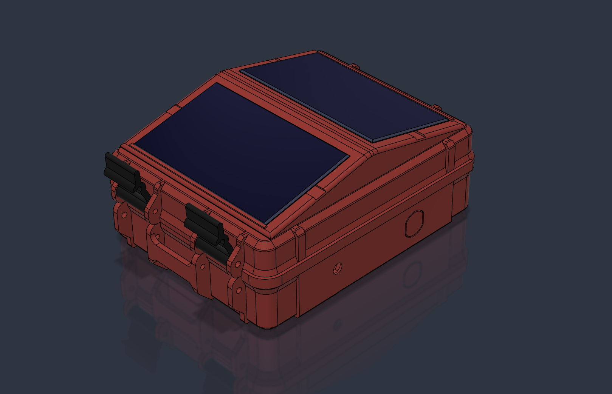
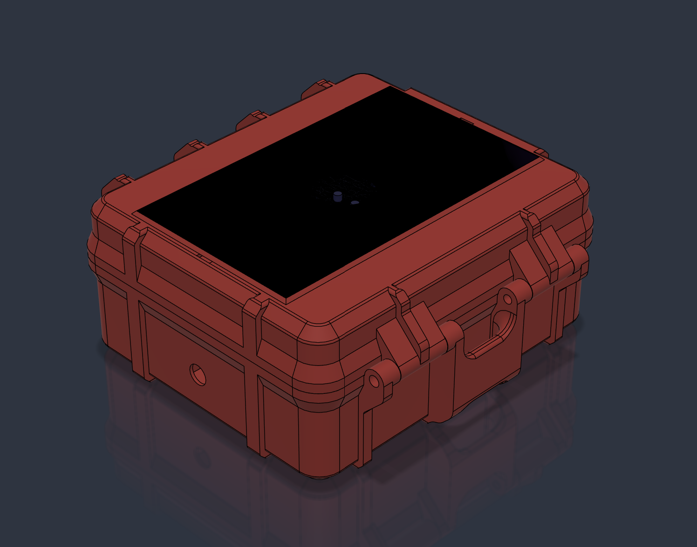

# Enclosure designs

Owner-supplied design images received 2026-11-13. These are CAD renders/screenshots,
not photographs of completed assemblies. Enclosure v3/v4 labels identify case
designs independently of Heltec board revisions.

[Case inventory](../../records/inventory.md#case-enclosure-inventory---2026-11-13)
owns physical quantities, fitted panels and empty holders. No print-file revision
has been matched to these images yet.

## v4

The owner identifies Cases 1–11 as v4 enclosures: three PETG and eight ASA.
Case 1 is PETG and is represented by the supplied render. See the inventory for
each case's holders, connectors and panels, including Cases 10/11 with no fitted
panels and a pass-through for larger 5 W panels. The render documents the design's
appearance rather than proving installed hardware or measured performance.

## v3

The owner identifies this screenshot as the v3 enclosure design. Physical case
quantity, material, panel rating, antenna ports and holder allocation have not
yet been reported for a v3 case.

