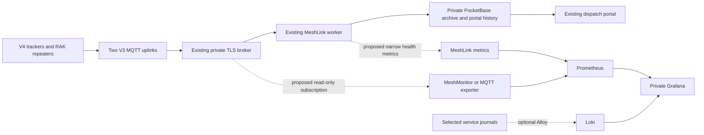

# Proposed private monitoring setup for SNORR MeshLink

2026-10-17 update: owner selects and authorizes internal-only MeshMonitor with the existing Grafana/Prometheus hosts, 30-day metrics and no automatic packet/history pruning. The bounded deployment and its verification limits are recorded in [operations](../operations/meshmonitor-lxc.md). Searchable logs and a custom MeshLink exporter are separate work. The proposal below remains the historical research context.

2026-10-16. Planning for [Check Meshtastic monitoring and recording stacks for the pilot](../../.scratch/pilot/issues/19-meshtastic-monitoring-research.md). This is a recommendation, not an accepted stack or authorization to deploy. [Project comparison](https://github.com/lfg-seth/snorr-meshlink/blob/f69b6a4/docs/research/meshtastic-monitoring-projects.md) contains the Meshtastic-specific shortlist and source evidence.

## Recommended direction

Add a private Grafana monitoring layer alongside the existing dispatch portal. First evaluate MeshMonitor in standalone MQTT `subscribe_only` mode as the most relevant packaged option: its current documentation provides an MQTT-only path, Prometheus metrics, a Grafana dashboard and a Proxmox LXC deployment guide. Confirm these features exist in the pinned release rather than assuming the newest default-branch documentation matches its container/template. A narrow exporter on our existing Python worker is the alternative if the packaged system adds too much duplicate functionality or cannot preserve receipt/freshness semantics. Add a small MeshLink-specific exporter for worker, archive, freshness and queue health either way.

 [MQTT bridge documentation](https://meshmonitor.org/features/mqtt-broker), [LXC guide](https://meshmonitor.org/deployment/PROXMOX_LXC_GUIDE.html), [metrics API](https://github.com/Yeraze/meshmonitor/blob/main/docs/api/REST_API.md). Retain the existing PocketBase archive and operational history. Add Loki with Grafana Alloy when searchable service logs are useful; start with selected systemd units rather than collecting every host log. This is our assessment of fit, not a claim that an upstream template implements these project-specific semantics.

Three different records serve different purposes:

| Record | Proposed home | Purpose |
| --- | --- | --- |
| Exact MQTT deliveries and operational observations | Existing private PocketBase archive/history | Recover original delivered bytes, decode additional fields later, retain separate gateway receipts and deduplicated operational observations |
| Numeric time series | Prometheus | Track voltage, temperature, airtime, report age, queue backlog, service/resource health |
| Service logs | systemd journal; optionally Alloy to Loki | Investigate disconnects, decoder/API errors, service restarts and backup failures |

Grafana queries configured data sources; a dashboard template alone does not establish a packet archive. Prometheus stores sampled time series, which cannot reconstruct every packet or restore missed events. [Grafana data sources](https://grafana.com/docs/grafana/latest/datasources/), [Prometheus storage](https://prometheus.io/docs/prometheus/latest/storage/).

If upstream exporters cannot preserve the existing measurement-time and gateway semantics, prefer exporting from our established worker rather than running a second independent decoder for authoritative freshness. A separate upstream exporter remains useful for exploratory radio charts. Neither path should make archive/API availability depend on Grafana or Prometheus. Installing a dashboard does not backfill earlier PocketBase records into Prometheus or a second database; historical import would be a separate explicit task with timestamp/dedup checks. Use the existing portal/history for prior operational observations.

## What we already have, and what is missing

- Recorded hosting: Ubuntu Proxmox LXC, 4 logical CPUs, 8 GiB RAM and 64 GiB root filesystem. It is a plausible evaluation host; current free resources, log/archive growth and physical-host headroom were not checked. Inspect these before choosing colocated services versus a separate LXC. No new radio or computer purchase is established as necessary. [Deployment record](../operations/portal-lxc.md).
- Existing transport: authenticated TLS broker on 8883; encrypted Meshtastic ServiceEnvelope traffic through G001/G002. The worker subscribes to `snorr/pilot/#`, but the documented read ACL is only `snorr/pilot/2/e/#`. A wildcard subscription cannot bypass that ACL. A new direct subscriber needs a distinct client ID and preferably a dedicated read-only account scoped to the project. Broker changes need the owner's broker administration path. [Live MQTT record](../operations/live-mqtt.md).
- Existing persistence: exact payload archive before normalization, durable private SQLite queue, separate gateway receipts and deduplicated positions. There is no archive expiry. QoS/disconnect/upstream gaps still prevent claiming complete RF history. Existing backups contain the archive but share the LXC disk; an off-host backup destination is outstanding. [Archive and recovery](../operations/live-mqtt.md#raw-mqtt-archive--2026-10-15).
- Existing health: Python worker has subscription state, per-process queued/unsupported/rejected/saved counters, heartbeat and bounded service-log reporting. It has no Prometheus endpoint, no exposed queue-depth/oldest-age metric, and no monitoring-service credential. Adding those is implementation work. Counter totals reset when the process restarts. [Worker source](../../backend/mqtt_worker.py).
- Existing telemetry: member/repeater voltage and R003 temperature/humidity are integrated; channel utilization, airtime, uptime and additional sensors require actual packet verification and normalization. Voltage alone does not measure solar production, charging current or battery endurance. [Telemetry evidence](../operations/repeater-telemetry.md), [neighbor research](node-neighbor-telemetry.md).

## Setup stages and concrete contents

1. **Confirm scope and choose the collector.** Compare a pinned MeshMonitor MQTT-only evaluation with a narrow exporter on our existing worker; use tcivie’s SQL/Grafana bundle as the alternative for a separate telemetry history database. Test private sanitized fixtures in isolation, then a read-only subscription if approved for implementation. Check pinned firmware/protobuf compatibility, certificate validation, custom root/channel/key handling, missing scalar values and duplicates from two gateways. Keep credentials/channel keys in the private provisioning path. Do not enable plaintext JSON uplinks just to satisfy an exporter: official Meshtastic docs identify JSON packets as unencrypted. [MQTT configuration](https://meshtastic.org/docs/configuration/module/mqtt/).
2. **Inspect capacity and define persistence.** Measure CPU/RAM/disk use and archive growth, including the existing 14 full local backups. Select native systemd services or a Compose deployment after inspecting LXC support; Docker nesting is not established. Pin component versions/images, use dedicated service users and persistent storage, define restart/update/rollback behavior and resource budgets. A separate monitoring LXC is an option if it protects the GPS path from resource contention; it still does not provide independent outage detection on the same physical host.
3. **Deploy metrics first.** Provision Grafana and Prometheus plus the chosen radio exporter and a narrowly scoped MeshLink health endpoint. Proposed starting scrape interval: 30 seconds, with slow-radio-report ages retained separately. Scraping faster never makes a 15-minute sensor report newer. Provision data sources, dashboards and rules from tracked configuration. Native Grafana provisioning supports file-backed sources and dashboards. [Provisioning documentation](https://grafana.com/docs/grafana/latest/administration/provisioning/).
4. **Add focused log search if needed.** Use Grafana Alloy to read only the worker/API/backup/Tunnel units that aid diagnosis and send sanitized entries to a single-process Loki. Alloy supports systemd journal selection and requires journal read permissions; grant them deliberately, since journal access is broader than a narrow application endpoint. Use short approved retention and validate redaction. Promtail reached end of life on March 2, 2026; old templates using it need updating. [Alloy journal source](https://grafana.com/docs/alloy/latest/reference/components/loki/loki.source.journal/), [Loki deployment modes](https://grafana.com/docs/loki/latest/get-started/deployment-modes/), [Promtail lifecycle](https://grafana.com/docs/loki/latest/send-data/promtail/).
5. **Keep access private.** Bind monitoring APIs/exporters to loopback or a private network. Start owner access through SSH forwarding; an additional browser route/access policy is a separate deployment choice. Give Grafana its own authenticated owner/admin access; existing PocketBase login does not automatically supply Grafana authorization. Avoid member names, coordinates, packet IDs, payloads and free-form errors as metric labels. Keep raw payloads and credentials out of log collection. Loki has no built-in HTTP authorization layer; do not expose it directly. [Prometheus security model](https://prometheus.io/docs/operating/security/), [Loki authentication](https://grafana.com/docs/loki/latest/operations/authentication/).
6. **Agree retention and prove recovery.** Candidate evaluation settings are 30 days of metrics and 7 days of service logs, with measured disk limits and safety headroom; these are proposals, not approved deletion policies. The current no-pruning pilot packet policy stays separate. Prometheus supports time/size retention limits; local storage is single-node and needs a backup plan. Back up Grafana configuration and any retained monitoring state that cannot be rebuilt, test restoration and select an off-host destination. Do not assume the existing MeshLink backup script includes new service state. [Prometheus storage/backup limits](https://prometheus.io/docs/prometheus/latest/storage/).

## Dashboard starting set

| View | Useful panels | Required interpretation |
| --- | --- | --- |
| GPS tracking quality | Position age per device; counts of fresh/stale/unknown trackers; update gaps; worker-to-API delay | Use GPS measurement time, existing 15-minute stale threshold and expected participating devices; receipt/contact time cannot refresh a fix. A replayed old point must still be old. |
| Radio and infrastructure | Voltage trends; reported temperature/humidity; report age; uptime/reset hints; channel utilization/airtime when available; per-gateway receipt counts and directional SNR/RSSI | Distinguish original sender from final-hop transmitter; preserve unknowns and direction. A gateway receipt rate is not end-to-end packet delivery percentage. Absence of reports is not proof of a failed radio. |
| Pipeline health | Exporter scrape status; MQTT subscription; last packet receipt by gateway; archive/normalization failures; queue count/oldest age; last successful API write | An exporter being up proves only that it answered a scrape. Raw delivery counts and unique report counts need separate labels/panels. A broker with no traffic can still be connected. |
| Host and recovery | Disk/RAM/CPU; service restarts; last successful backup; restore-check age; certificate lifetime where observable | Report monitoring failures as unknown; preserve last evidence. Certificate checks and broker-host metrics require reachable interfaces/administrative access, not just MQTT subscription. |

Use only available readings at first. NeighborInfo has slow firmware-specific cadence and missing hearing timestamps; the parked custom firmware telemetry proposal remains parked. A Grafana line must not imply a complete mesh topology or a measured RF path. [Signal semantics and pinned limitations](node-neighbor-telemetry.md).

## Acceptance checks before operational use

These are planned checks, not measured results:

- Two gateway copies produce two reception records and one underlying report in unique-report charts; do not merge different payloads that reuse a packet ID.
- A replayed old GPS fix stays old; absent measurement time stays unknown; a cached exporter gauge does not appear freshly measured on every scrape.
- Stop/disconnect one exporter, gateway, broker connection and API independently: panels identify the layer that lost evidence. Queue growth/draining survives the intended restart/API-outage cases. Monitoring failure does not stop existing ingestion.
- Compare exported voltages/environmental readings and timestamps with actual stored reports; unknown RSSI/SNR remain unknown, and relayed receptions retain proper source meaning. Verify each desired metric actually reaches the broker.
- Restart services, restore the selected monitoring backup, verify anonymous/private-API denial, check secrets and raw payloads do not enter metrics/logs, and measure disk growth and GPS-path performance under collection.
- Internet or broker loss remains an outage for remote dashboards. Grafana does not add a local radio receiver, offline maps, or store-and-forward recovery. Existing phone-optional tracking/local field viewing requirements still need their own verification.

## Decisions still needed

The owner has requested exploration, not installation. Next decide whether to run a metrics-only evaluation first or include log search immediately, then select the collector and hosting arrangement. Retention, role/access details, storage budget and operational ownership can be sharpened after the collector and scope are accepted. Existing silent infrastructure badges remain the warning policy; no Slack, paging or other external notification integration is activated by this research.
