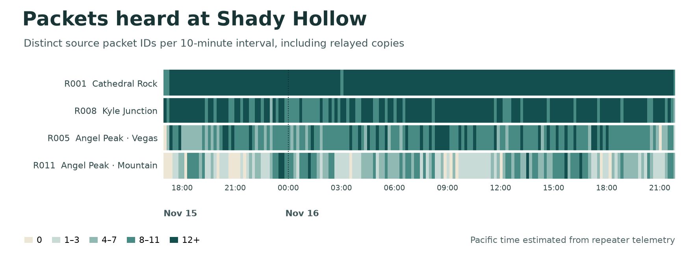

# Shady Hollow offline reception, November 15–16, 2026

G002 at Shady Hollow repeatedly heard **Kyle Junction, both sides of Angel Peak and Cathedral Rock**. All four repeaters also reported hearing G002 directly. Kyle Junction traffic arrived at least once every three minutes between its first and last receptions. The longest gap from the Angel Peak Mountain Side radio was **50 minutes 58 seconds**, even counting relayed copies.

## Repeater reception

The final boot covers **28 h 55 min**, from approximately **16:57 Sunday, November 15 to 21:52 Monday, November 16 Pacific**. It starts during the documented Shady Hollow setup. All four repeaters also produced packets with direct headers in every hourly interval between 2 and 26 hours after boot, well into the recording. The exact installation and pickup times are unknown. [Placement account](2026-11-15-mount-charleston.md), [setup verification](../../docs/operations/g002-shady-hollow-deployment.md).

| Source | Distinct packet IDs | RF copies heard | Copies with direct headers | Median direct RSSI / SNR | Longest gap, any path | Peer reports listing G002 / received |
| --- | ---: | ---: | ---: | ---: | ---: | ---: |
| R001 · Cathedral Rock | 2,272 | 3,995 | 2,251 | −86 dBm / +4.0 dB | 5 min 9 s | 530 / 531 |
| R008 · Kyle Junction | 2,125 | 3,296 | 1,976 | −97 dBm / −4.5 dB | 2 min 59 s | 468 / 468 |
| R005 · Angel Peak Vegas Side | 1,657 | 1,859 | 1,646 | −103 dBm / −10.25 dB | 15 min 58 s | 242 / 242 |
| R011 · Angel Peak Mountain Side | 881 | 935 | 848 | −105 dBm / −12.5 dB | 50 min 58 s | 168 / 168 |

RF copies include repeats of the same source packet. The direct-header column counts successful reads with positive, unchanged hop count, a last-relay byte matching the source and the MQTT flag clear. RSSI and SNR summarize those copies at G002. Gaps are between consecutive successful receptions from the same source, through any path. The peer column counts distinct SNNS neighbor reports in which the repeater itself listed G002 as a recent direct neighbor. Independently, G002 listed Cathedral Rock, Kyle Junction and Vegas Side in 328 of its 331 local neighbor reports each, and Mountain Side in 312. A neighbor can remain listed across reports. The number of transmissions attempted by each repeater is unknown, so the card cannot give a delivery percentage.

The longest Mountain Side gap ran from about **20:32 to 21:23 Sunday**. Direct-header copies from Mountain Side were **72 minutes** apart across that interval. G002 kept receiving the other repeaters. No valid packet originated from **R006 Lee Junction, R010 Upper Bristle or G001 Lee Fire** during this boot. All three appear in earlier segments, before the Shady Hollow setup. The card also contains four late G006-originated packets, all with a last-relay byte matching R005.

## Member GPS

G002 decoded **10 distinct, timestamped B002 fixes** near the beginning of the final boot. The measurement times span about 27 minutes, with a longest interval of **11 min 54 s**. Estimated age at G002 reception was **6–57 seconds** using the peer-derived clock below. The recorder then ran **28 h 25 min** past the last B002 fix. B003 supplied **11 battery reports** and zero decoded positions. Its final four reported battery levels fell from **15% to 4%**, ending at **3.188 V**. Carrier presence, phone use, subsequent runtime and dispatch receipt were unobserved. The fixes demonstrate a short local tracking interval. [Pilot freshness and runtime criteria](../../PROJECT.md#mission-and-priorities).

## Power observations

The [per-node power summary](2026-11-16-g002-power.md) includes battery levels and voltages for every reporting radio, sensor current and estimated charge balance for the five field nodes with current measurements, and the earlier setup readings.

- G002 recorded **348** local device-voltage readings, starting at **4.285 V** and ending at **4.022 V**. Its **347** INA219 channel 1 samples had a median **114.6 mA in the discharge direction**. The reading gap stayed below 5 min 1 s. Trapezoidal integration of the samples gives approximately **2.67 Ah net discharge across the sensor path in 28.87 hours**. Board calibration and total pack current remain unverified. End-of-battery runtime was unobserved. [Current convention](../../docs/operations/radio-report-ingestion.md#fleet-current-polarity-correction---2026-10-24).
- R001 reached **249.2 mA in the charge direction** at approximately **08:44 Monday**. Its 20 samples during 09:00–10:00 had a median of about **+76 mA**, ranging from **−4.2 to +241.4 mA** in the project’s positive-charging convention. The earlier field observation of about 16 mA was one reading on Sunday. Panel output and the cause of the earlier low reading remain open.
- None of the **236** received R011 channel 1 samples showed charging under that convention. They ranged from **9.5 to 38.9 mA in the discharge direction**. Only three samples arrived during Monday’s 09:00 hour. Solar performance during missing intervals is unknown.

## Card integrity and timing

All **25 consecutive SML files** belonged to G002 (`!1bbf0ab8`), totaling **6,612,854 bytes** across **20 boot IDs**. Each local copy matched the source file by SHA-256. The [project reader](../../scripts/sd-reader/reader.js) validated **69,772 event frames**. The first 24 segments had valid close markers. The final segment ended on a valid event with no close marker. The last successful write is the evidence boundary. The reason recording ended and any unwritten tail are unknown.

The field counts use only segments **00000017–00000019** (hex), which share the final boot ID. The earlier USB sync check explicitly identified segment 23 decimal (`00000017`). Final-boot event sequence **1–29,334** is complete, with no recorder-loss event or MQTT publish event. Of **13,158** raw radio reads, **12,004** had successful status and a full packet header, **1,152** returned radio read error −7 and **two** successful reads had no header bytes. Error and empty reads were excluded from source and signal counts. Of the valid copies, **1,790** were G002’s own packets heard back over the air. All **7,010** received application decode events matched an individual raw read by sequence, source and packet ID.

G002 recorded no valid UTC on this boot. The wall-clock estimate uses the median of **5,470** remote telemetry timestamps minus G002’s receipt uptime from R001, R008, R005 and R011. Each repeater independently placed boot time within approximately two seconds of the combined estimate. Quoted local times are approximate. Durations and gaps use G002’s monotonic clock, and GPS intervals use the measurement timestamps. Source files, per-file hashes and analysis inputs are retained in ignored `local-data/g002-offline-20261116/`.
