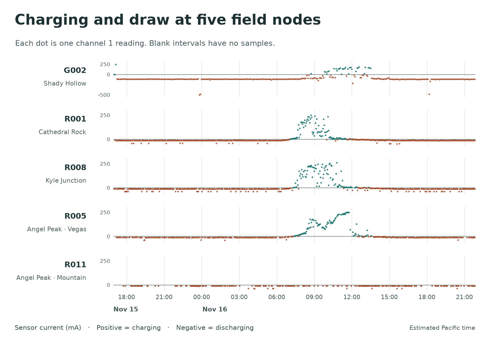

# Power and charging by node from the G002 card

The Shady Hollow recorder covered approximately **16:57 November 15 to 21:52 November 16 Pacific**. In the sampled intervals, G002 drew about **2.67 Ah net**. Angel Peak Vegas Side gained about **340 mAh**, Kyle Junction **175 mAh** and Cathedral Rock **16 mAh**. All received current readings from Angel Peak Mountain Side showed discharge, with gaps of up to 81 minutes in its channel 1 reports.

## Field battery readings

Battery volts come from device telemetry. The first and last readings follow card order. Each radio estimates its own battery percentage. **P** is the radio’s external-power flag (wire value 101). Percentages exclude that flag. The voltage range includes all readings.

| Node | Device reports | Battery V, first → last | Battery V range | Level, first → last | Level range (%) and P count |
| --- | ---: | ---: | ---: | ---: | ---: |
| G002 · Shady Hollow | 348 | 4.285 → 4.022 | 4.022 to 4.285 | P → 85% | 85–100, P × 4 |
| R001 · Cathedral Rock | 574 | 3.677 → 3.682 | 3.668 to 3.743 | 45% → 45% | 44–52 |
| R008 · Kyle Junction | 556 | 3.769 → 3.791 | 3.758 to 3.849 | 56% → 58% | 54–65 |
| R005 · Angel Peak Vegas Side | 498 | 3.848 → 3.872 | 3.841 to 3.928 | 65% → 68% | 64–73 |
| R011 · Angel Peak Mountain Side | 226 | 4.153 → 4.141 | 4.134 to 4.154 | 97% → 96% | 96–97 |
| B002 · Member node | 6 | 3.606 → 3.603 | 3.603 to 3.606 | 37% → 37% | 37 |
| B003 · Member node | 11 | 4.195 → 3.188 | 3.188 to 4.195 | 100% → 4% | 4–100 |
| G003 · Mobile gateway | 12 | 4.154 → 4.259 | 4.079 to 4.280 | 97% → P | 92–97, P × 4 |
| G006 · Terry Home assignment | 2 | 3.484 → 3.700 | 3.484 to 3.700 | 25% → 47% | 25–47 |

B002’s six reports all arrived around setup. B003 reported 99–100% early, then 15%, 13%, 9% and 4% late, with about 28 hours between the two clusters. G003 had four external-power flags. G006’s two samples came about 18 minutes apart, with lower reported device uptime on the second. These four nodes supplied battery voltage and level only. Their charge current is unknown.

## Field sensor current and energy

Positive current means charging and negative means discharging along the measured sensor path. Charging counts are numbers of positive samples. They describe the readings G002 captured. Sensor calibration, total pack current and solar-panel output were unmeasured. [Fleet current convention](../../docs/operations/radio-report-ingestion.md#fleet-current-polarity-correction---2026-10-24).

| Node | Channel 1 bus V range | Channel 1 mA range | Median mA | Charging / all samples | Longest gap (min) |
| --- | ---: | ---: | ---: | ---: | ---: |
| G002 | 3.864 to 4.200 | −497.8 to +243.1 | −114.6 | 34 / 347 | 5.0 |
| R001 | 3.652 to 3.736 | −48.5 to +249.2 | −12.8 | 92 / 574 | 6.0 |
| R008 | 3.732 to 3.848 | −40.2 to +261.5 | −11.5 | 93 / 537 | 12.0 |
| R005 | 3.836 to 3.932 | −40.6 to +250.0 | −11.4 | 96 / 450 | 18.0 |
| R011 | 4.100 to 4.116 | −38.9 to −9.5 | −10.7 | 0 / 236 | 81.0 |

Charge and draw below are approximate milliamp-hours between consecutive channel 1 readings at most **10 minutes apart**. Current is linearly interpolated between those readings and split at zero when it changes direction. Longer gaps and time outside the samples are omitted. Each column is rounded independently.

| Node | Hours included of 28.92 | Charge (mAh) | Draw (mAh) | Net (mAh) |
| --- | ---: | ---: | ---: | ---: |
| G002 | 28.87 | 288 | 2959 | −2671 |
| R001 | 28.80 | 339 | 322 | +16 |
| R008 | 28.70 | 514 | 339 | +175 |
| R005 | 27.49 | 600 | 260 | +340 |
| R011 | 14.37 | 0 | 170 | −170 |

- **G002** had a median draw of 117.4 mA between midnight and 06:00. Its largest positive sample (+243.1 mA) came near Sunday setup. Monday’s 07:00–16:00 peak was +178.6 mA around 12:34. Charging replaced about one tenth of its measured draw over the run.
- **R001** recorded positive samples between about 07:01 and 12:02 Monday and peaked at +249.2 mA around 08:44. It finished within 0.005 V of its starting voltage.
- **R008** recorded positive samples between about 07:17 and 13:20 Monday and peaked at +261.5 mA around 10:47. **R005** recorded positive samples between about 07:12 and 13:34 and peaked at +250.0 mA around 11:34. Vegas Side accumulated the larger observed net gain.
- **R011** stayed at 96–97% reported battery level. All 236 channel 1 and all 244 environmental-current readings showed discharge. Only 14.37 hours met the integration rule. Its full-run energy balance and solar performance remain open.

## Earlier recordings on the card

Segments 1–22 predate the final Shady Hollow boot and include multiple power cycles and setup conditions. These ranges combine the earlier recordings without estimating energy across restarts. A dash means the card contains no reading of that kind in these segments. The legacy Heltec V3 is the former G001. [Identity history](../../docs/operations/g001-screenless-rollout.md).

| Node | Device reports | Battery V range | Level range (%) and P count | Channel 1 bus V range | Channel 1 mA range | Median mA | Charging / all samples |
| --- | ---: | ---: | ---: | ---: | ---: | ---: | ---: |
| B002 | 83 | 3.612 to 4.067 | 38–91 | — | — | — | — |
| B003 | 129 | 4.121 to 4.375 | 95–100, P × 116 | — | — | — | — |
| G001 | 54 | 3.937 to 4.116 | 74–94 | 3.836 to 4.024 | −178.4 to −119.9 | −132.8 | 0 / 85 |
| G002 | 74 | 3.706 to 4.315 | 48–91, P × 13 | 3.636 to 4.212 | −133.4 to +525.0 | +523.2 | 88 / 97 |
| G003 | 14 | 3.077 to 4.179 | 0–99 | — | — | — | — |
| Legacy V3 | 80 | 4.323 to 4.352 | P only | — | — | — | — |
| R001 | 83 | 3.680 to 3.805 | 45–51, P × 77 | 3.664 to 3.800 | −13.8 to +313.4 | +307.5 | 136 / 143 |
| R002 | 91 | 3.662 to 3.738 | 43–44, P × 87 | 3.648 to 3.712 | −13.6 to +326.4 | +321.2 | 137 / 143 |
| R004 | 100 | 3.810 to 4.224 | P only | 3.784 to 4.204 | −0.2 to +300.4 | +284.1 | 136 / 142 |
| R005 | 103 | 4.096 to 4.215 | P only | 4.044 to 4.232 | −0.2 to +223.3 | +92.5 | 137 / 143 |
| R006 | 93 | 3.807 to 3.998 | P only | 3.772 to 3.968 | +277.9 to +299.8 | +288.4 | 138 / 138 |
| R007 | 86 | 3.782 to 4.212 | P only | 3.736 to 4.192 | −10.1 to +300.2 | +293.2 | 139 / 140 |
| R008 | 100 | 3.767 to 4.181 | 55–95, P × 95 | 3.752 to 4.176 | −11.2 to +238.1 | +214.6 | 135 / 141 |
| R009 | 90 | 4.109 to 4.163 | 94, P × 87 | 4.068 to 4.124 | −35.1 to +205.5 | +181.9 | 136 / 140 |
| R010 | 90 | 3.662 to 3.748 | 43, P × 87 | 3.660 to 3.740 | −12.5 to +312.3 | +309.1 | 135 / 140 |
| R011 | 6 | 3.746 to 3.793 | P only | — | — | — | — |

G001 (Lee Fire), R002, R004, R006 (Lee Junction), R007, R009, R010 (Upper Bristle) and the legacy V3 appear only in the earlier power data. R003 supplied no power telemetry anywhere on the card. The 85 G001 current readings all showed discharge before the field run. This card provides no on-site test of G001’s charging at Lee Fire.

## Environmental voltage and current

These separately timed reports are another view of the repeater sensor. The energy calculation uses channel 1 alone so the two streams do not count the same electrical path twice. All current values below use the same positive-charging convention.

| Node | Field bus V | Field mA range | Field charging / samples | Earlier bus V | Earlier mA range | Earlier charging / samples |
| --- | ---: | ---: | ---: | ---: | ---: | ---: |
| R001 | 3.648 to 3.732 | −48.0 to +251.0 | 92 / 573 | 3.668 to 3.800 | −12.7 to +311.4 | 88 / 93 |
| R002 | — | — | — | 3.652 to 3.716 | −11.8 to +324.6 | 86 / 90 |
| R004 | — | — | — | 3.788 to 4.208 | −0.2 to +300.4 | 69 / 76 |
| R005 | 3.836 to 3.932 | −39.8 to +252.8 | 102 / 452 | 4.068 to 4.224 | −0.2 to +224.7 | 73 / 80 |
| R006 | — | — | — | 3.776 to 3.964 | +280.8 to +298.4 | 73 / 73 |
| R007 | — | — | — | 3.740 to 4.184 | +0.0 to +300.2 | 92 / 93 |
| R008 | 3.736 to 3.848 | −38.5 to +268.0 | 111 / 550 | 3.752 to 4.176 | −36.6 to +237.2 | 80 / 85 |
| R009 | — | — | — | 4.072 to 4.124 | −37.9 to +209.4 | 86 / 90 |
| R010 | — | — | — | 3.660 to 3.740 | −11.8 to +312.2 | 73 / 77 |
| R011 | 4.100 to 4.120 | −38.8 to −9.5 | 0 / 244 | — | — | — |

## Evidence

All 25 local segments matched the card’s SHA-256 manifest. The scan decoded received and local outbound Meshtastic telemetry by source and packet ID. It found **9,681 distinct packets with measurements** across 17 physical radios. The field boot had 2,233 device, 2,144 channel 1 power and 1,819 environmental reports. The earlier segments had 1,276 device, 1,452 channel 1 power and 757 environmental reports. One empty local telemetry request was excluded. G002’s uptime determines intervals. Four repeaters provide the approximate Pacific clock. [Recording, clock reconstruction and card integrity](2026-11-16-g002-offline-card.md#card-integrity-and-timing).
