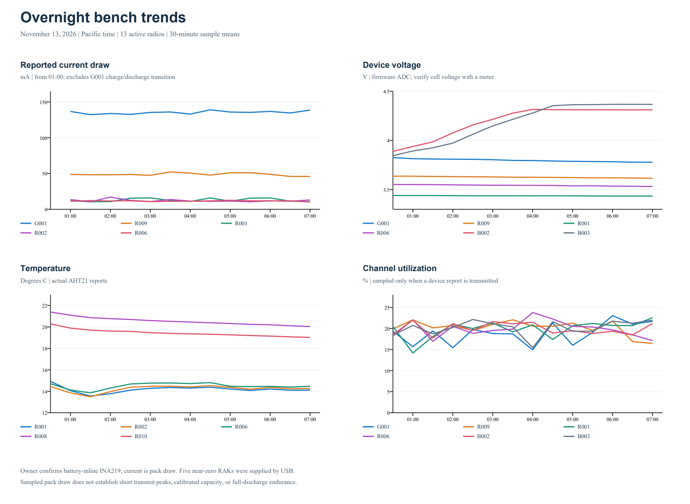

# Overnight bench analysis — November 13, 2026

Read-only analysis of the existing production MQTT archive. Main comparison:
**00:30:00–07:14:21 Pacific**, 6 hours 44 minutes, after the recorded G001
firmware/application rollout. Context: **18:00 November 12–07:14 November 13**,
13 hours 14 minutes. These are archive windows, not assertions about when each
board was powered on. Current physical radio IDs were matched using the fresh
deployment roster; historical R/G names were not used as physical identities.

## Overall finding

All **13 active radios** continued reporting. No device-uptime decrease,
custom-report boot-ID change, unknown-clock telemetry, future telemetry timestamp
or source-time regression was observed after 00:30. **3,032** overnight
telemetry packets had plausible UTC. No decode exceptions occurred. R003 is
absent and remains the previously held radio; this run does not clear its hold.

The run supports sustained bench continuity, two-uplink reception, member GPS
freshness and G001 logging health. It also exposes late reporting, uncalibrated
power readings, three portal enrollment gaps, and R009's missing GPS
measurement timestamp. It is not battery endurance, field coverage, forced-relay
or full SD-file integrity acceptance.

## Current and voltage

Sample means and sampled ranges, not continuous electrical averages or TX peaks.
**Positive current in this table means discharge/draw; negative means charging**,
using the wire polarity. The portal/dashboard reverses this sign for display.
Device ADC and INA219 voltage remain separate measurements.

| Node | INA219 current, mA: mean (sample range) | Device V: first → last | INA219 V: first → last | Firmware battery status: first → last |
| --- | --- | --- | --- | --- |
| R001 | 12.86 (6.5 to 48.2) | 3.440 → 3.434 | 3.436 → 3.428 | 21 → 21 |
| R002 | 12.47 (6.8 to 41.2) | 4.089 → 4.085 | 4.076 → 4.072 | 92 → 92 |
| R004 | -0.02 (-0.2 to 0.2) | 4.174 → 4.181 | 4.156 → 4.200 | 101 throughout |
| R005 | -0.02 (-0.4 to 0.4) | 4.105 → 4.073 | 4.228 → 4.060 | 101 throughout |
| R006 | 11.83 (7.6 to 44.1) | 3.552 → 3.533 | 3.520 → 3.500 | 32 → 30 |
| R007 | -0.23 (-0.6 to 0.2) | 4.128 → 4.188 | 4.112 → 4.196 | 101 throughout |
| R008 | -0.28 (-0.6 to 0.1) | 4.188 → 4.161 | 4.188 → 4.084 | 101 throughout |
| R009 | 48.82 (40.6 to 80.3) | 3.641 → 3.614 | 3.608 → 3.580 | 41 → 38 |
| R010 | -0.26 (-0.7 to 0.0) | 4.195 → 4.177 | 4.196 → 4.056 | 101 throughout |
| G001 | 135.3 (125.4 to 158.0); 01:00 onward | 3.858 → 3.778 | 3.908 → 3.656 | 66 → 57 |
| Legacy V3 | Not measured | 4.342 → 4.336 | — | 101 throughout |
| B002 | Not measured | 3.867 → 4.311 | — | 67 → 101 |
| B003 | Not measured | 3.819 → 4.367 | — | 62 → 101 |

Firmware status **101 means charging or no detected battery**, not 101% state
of charge. Battery percentages are firmware estimates; they do not measure
capacity or calibrate the ADC.

**Owner clarification, November 13:** the run used mixed USB and battery power;
the nodes showing sustained current were battery-powered, and the INA219 is
inline with the battery pack. This identifies G001/R001/R002/R006/R009 as the
battery-draw group in these measurements. The near-zero RAKs were supplied by
USB, so their readings do not indicate a current-sensor fault or near-zero
whole-node consumption. For the battery-powered nodes, the reported current is
draw from the pack, subject to shunt calibration and sparse sampling. The
clarification does not establish pack capacities or full-discharge runtime.

- **G001:** after 01:00, 73 power samples average **135.3 mA**, median 136.6,
  range 125.4–158.0. Half-hour means mostly remain 132–139 mA; no progressive
  current rise appears. Latest sample: 150.3 mA. The initial 00:30-window sample
  is **−537.7 mA**, followed by discharge; including that transition gives a
  misleading 126.9 mA overall mean. Device voltage falls 3.858→3.778 V and its
  estimate 66→57%; after 01:00, device voltage is 3.815→3.778 V. INA219 reads
  roughly 0.11–0.12 V below the device ADC during steady operation. With the
  battery-inline path confirmed, this is reported pack draw. A meter comparison
  can establish calibration and explain the two voltage readings before final
  energy or solar/runtime sizing.
- **R001/R002/R006:** sampled mean draw is 12.9/12.5/11.8 mA. Voltage changes
  slowly. R001 finishes at only **3.434 V / 21% estimated**, R006 at
  **3.533 V / 30%**; these have less reported charge headroom than R002.
- **R009:** 48.8 mA mean, 40.6–80.3 sampled range; about four times the
  11.8–12.9 mA group. Its fitted GNSS is a plausible contributor, but no
  controlled GPS-off comparison was made. Device voltage falls 3.641→3.614 V,
  estimated level 41→38%.
- **R004/R005/R007/R008/R010:** all average within 0.3 mA of zero despite
  active RF reporting. The owner confirms the mixed-power setup: these nodes
  were supplied by USB while their shunts monitored the battery path. Their
  near-zero battery-path readings are therefore consistent with the setup and
  do not establish a sensor fault or whole-node consumption.
- **B002/B003:** device voltage rises to plateaus at **4.311/4.367 V**, and
  status becomes 101; this resembles charging, rather than a battery-only
  discharge test. Legacy V3 also reports about 4.34 V and status 101. Verify
  those above-4.3-V ADC readings at the cell with a meter; the archive cannot
  distinguish ADC scaling from actual cell voltage. Neither member exports
  INA219 current, so their draw is unknown.

### Conditional daily battery budget

Multiplying the sampled discharge means by 24 hours gives approximately:

| Battery-powered node | Sample mean draw | Equivalent charge per 24 h |
| --- | --- | --- |
| R001 | 12.86 mA | 309 mAh |
| R002 | 12.47 mA | 299 mAh |
| R006 | 11.83 mA | 284 mAh |
| R009 | 48.82 mA | 1,172 mAh |
| G001 | 135.33 mA, steady period | 3,248 mAh |

These are budgeting extrapolations if the same load continues, not measured
24-hour consumption or remaining runtime. R009 is about four times the ordinary
RAK group's draw; G001 is about eleven times. Usable pack capacity, cutoff,
temperature and a representative discharge run are still needed for runtime.

## Reporting cadence and airtime

Receipt intervals below are **median / longest**, in minutes. Saved baselines
are 3 minutes for ordinary device/environment/power, 5 for G001. Environmental
packets may contain only INA219 voltage/current; a packet does not imply an
AHT21 temperature/humidity sensor exists.

| Node | Device gap, min | Environment gap, min | Power gap, min | Mean channel busy, % | Mean own TX airtime, % |
| --- | --- | --- | --- | --- | --- |
| R001 | 4.06 / 16.95 | 4.82 / 20.08 | 3.00 / 6.14 | 19.7 | 3.23 |
| R002 | 4.06 / 24.04 | 4.17 / 15.93 | 3.00 / 6.15 | 19.7 | 3.20 |
| R004 | 4.19 / 22.78 | 4.07 / 9.01 | 3.00 / 6.01 | 20.4 | 3.39 |
| R005 | 4.14 / 12.99 | 4.22 / 9.18 | 3.00 / 5.80 | 19.2 | 3.19 |
| R006 | 4.04 / 15.08 | 4.01 / 14.99 | 3.00 / 6.07 | 19.6 | 3.46 |
| R007 | 3.99 / 20.19 | 4.09 / 9.08 | 3.00 / 6.05 | 19.2 | 2.87 |
| R008 | 4.09 / 16.93 | 4.02 / 14.57 | 3.00 / 6.31 | 21.4 | 3.29 |
| R009 | 4.06 / 14.11 | 4.16 / 26.14 | 3.00 / 5.88 | 20.2 | 3.14 |
| R010 | 4.28 / 15.43 | 4.19 / 21.00 | 3.00 / 6.08 | 19.6 | 3.00 |
| G001 | 7.00 / 11.00 | — | 5.00 / 10.00 | 18.8 | 1.24 |
| Legacy V3 | 4.01 / 22.00 | — | — | 20.1 | 2.18 |
| B002 | 4.17 / 21.84 | — | — | 19.8 | 2.68 |
| B003 | 4.19 / 13.14 | — | — | 20.2 | 2.57 |

The nine active RAKs supplied **78–86 device reports** each, compared with about
135 nominal three-minute opportunities, and **128–134 power reports** each.
This ratio is schedule coverage, not RF packet-delivery probability: attempted
transmissions were not independently counted. Power cadence centers on 180 s,
whereas device/environment reports usually center near 240–257 s, with longer
tails. R001 environment has a 289 s median. Device gaps reach 24.0 min on R002,
22.8 min on R004, 21.8 min on B002, and 20.2 min on R007.

Long intervals also occur between embedded source timestamps (for example,
R002 1,440 s, R004 1,380 s, B002 1,321 s). The pattern is therefore not explained
by gateway-to-server delay alone. Both gateways receive essentially the same
remaining packets. Sender scheduling/airtime admission or loss before either
gateway receives a packet remain possibilities. No serial diagnostic was
captured, so the cause is unisolated.

Received device reports average **18.8–21.4% channel utilization**; RAK own
TX airtime averages 2.87–3.46%, G001 1.24%, Legacy V3 2.18%, and members
2.57–2.68%. Most transmitted device reports stay just below 25%. This is a
sampling limitation: the pinned CLIENT device/environment modules consult a
25% polite channel-utilization gate, whereas PowerTelemetry uses a different
admission check. Received reports cannot prove the channel never exceeded 25%
between transmissions. The observed pattern is consistent with airtime
deferrals but does not establish their exact count or exclude collisions.

## Radio delivery, neighbors and portal ingestion

**4,838 unique selected-node packets** arrived. G001 archived **4,831** and
Legacy V3 **4,835**; **4,828** were seen through both. The union shows that
each uplink saw **99.86% / 99.94%** of packets observed by at least one uplink.
These figures cannot count packets missed by both, and include gateway-local
copies; they are not independent over-the-air delivery ratios. Both member
nodes' packets reached both uplinks **323/323 and 333/333**.

Neighbor totals stayed at **11–12**, with no reported capacity eviction.
SNNS reports contain eight-row rotating subsets, so eight rows do not mean only
eight neighbors exist. Standard NeighborInfo is counted separately.

**R006 is the relative RF outlier:** median RSSI/SNR at G001 is −75 dBm / 2 dB,
versus −99 dBm / 4.5 dB at Legacy V3; G001 samples dip to −9 dB SNR. Nevertheless,
all 390 R006 packets reach both gateways. Other radios generally have much
stronger bench signals. Different antennas, receiver calibration and placement
prevent interpreting cross-board RSSI differences as a fault diagnosis.
Most reported paths have zero decremented hops; this does not verify a
forced-relay path or deployment coverage.

**Portal ingestion gaps:** every overnight transport envelope from fresh
**R004 (822), R006 (780), and R008 (796)** is marked **unknown source** by the
normal worker. The independent roster-aware decoder successfully reads their
telemetry from the retained archive. Reconcile those physical IDs with the
portal registry before depending on portal cards or warnings for them. This
analysis makes no registry/configuration change. Other unsupported packets
include ordinary app types without a normalized portal representation; an
unsupported flag alone is not RF failure.

## GPS

| Node | Position packets | Median / longest arrival gap | GPS measurement age at arrival | Satellites | PDOP |
| --- | --- | --- | --- | --- | --- |
| B002 | 156 | 153.3 / 315.8 s | median 33.0 s; maximum 106.0 s | 7–15 | median 1.55; worst 4.65 |
| B003 | 155 | 154.3 / 359.7 s | median 34.9 s; maximum 86.4 s | 5–15 | median 1.69; worst 9.87 |
| R009 | 7 | 3,627.1 / 3,644.9 s | **Unknown: timestamp omitted in every report** | 19–22 | 0.84–0.98 |

Both members deliver fresh timestamped fixes, although the typical interval is
about 2.6 minutes against a two-minute setting. Every received member fix is
under the 15-minute pilot age limit, and the observed interarrival gaps are
well below it. B003 has intermittent poor geometry (PDOP up to 9.87), so freshness
does not imply uniform positional quality. Altitude ranges are 728–785 m on
B002 and 710–790 m on B003; with stationary bench placement these would indicate
vertical solution variation, but no horizontal accuracy or surveyed truth was
measured. Coordinates and location tracks were not exported.

R009 has valid position transmit/clock-sharing time and strong reported
satellite geometry, but no separate GPS measurement timestamp. Its approximately
hourly packet cadence matches the saved one-hour setting; it cannot demonstrate
15-minute end-to-end measurement freshness. Keep receiver update interval,
transmitted position interval, transmit clock and GPS measurement age distinct.

## Temperature and humidity

| Node | Temperature °C: first → last | Observed range °C | Relative humidity %: first → last |
| --- | --- | --- | --- |
| R001 | 15.48 → 14.07 | 13.56–15.48 | 34.38 → 37.33 |
| R002 | 14.87 → 14.21 | 13.44–14.87 | 37.80 → 42.30 |
| R006 | 15.09 → 14.42 | 13.78–15.09 | 43.02 → 43.99 |
| R008 | 21.44 → 20.02 | 19.96–21.48 | 37.14 → 44.06 |
| R010 | 20.47 → 19.00 | 19.00–20.47 | 35.22 → 43.43 |

All five fitted/detected AHT21 units trend cooler and more humid overnight,
without abrupt high-temperature excursions. R001/R002/R006 cluster near 14°C
at the end, R008/R010 near 19–20°C. The archive does not establish whether that
difference is placement, local heating or calibration. R004/R005/R007/R009 lack
actual temperature/RH readings; this matches their unverified AHT21 status and
is not newly diagnosed sensor failure.

## Gateway and SD logging

G001 has **67/67** health reports with Wi-Fi and MQTT connected; Legacy V3 has
**91/91**. G001 Wi-Fi remains **−34 to −33 dBm**, channel 5, with the reported
association counter unchanged. No sustained backhaul outage is visible; brief
events between sampled reports cannot be excluded.

G001 emits **69 unique SD generations**, one boot, advertised interval **300 s**,
all healthy flags 15 and **zero dropped records**. The actual SD receipt gap is
median **330.2 s**, maximum **660.3 s**. Storage rises **3,080,192→6,651,904 bytes**
over 24,135 report-uptime seconds: approximately **0.533 MB/hour** or
**12.8 MB/day** if this load continues. Latest reported used space is only
**0.0209% of 31,902,400,512 bytes**. This is filesystem allocation growth,
not exact encoded payload size or a measured retention limit.

The current five-minute SD cadence supersedes this checkout's earlier daily
baseline. The completed rollout record on branch `codex/g001-sd-cadence`
identifies firmware **5bd492399** and MeshLink **0.3.1**, with deliberate G001
restarts/update just before 00:30. Earlier evening boot changes and outages
overlap active provisioning; they are retained as context and are not labeled
spontaneous overnight failures. Two early SNSD rejections occur outside the
main overnight window, during that compatibility transition; none occur after
00:30. Physical copied-card parsing, per-packet completeness and reboot
recovery remain unverified by the archive alone.

## SD capacity under heavier traffic — sizing scenarios

The owner asks about 100 nodes and 100% channel utilization. These estimates use
the observed 12.786 MB/day growth and 31.896 GB remaining. MB/GB are decimal.
No high-load hardware test or synthetic radio transmission was performed.

| Scenario | Estimated storage per day | Time until remaining space is used |
| --- | --- | --- |
| Observed 13-node bench mix | 12.8 MB | 2,495 days / 6.8 years |
| 100 nodes, proportional per-node bench mix | 98.4 MB | 324 days / 10.7 months |
| 100% channel busy, proportional to roughly 20% observed | 63.9 MB | 499 days / 16.4 months |
| Deliberately padded stress budget | 300 MB | 106 days / 3.5 months |

The first two extrapolations are separate sensitivity cases. Multiplying the
same 13-node traffic mix by 100/13 would also scale roughly 20% busy time to
154%, which a single channel cannot provide as sequential successfully received
frames. Thus the 100-node row is a storage-demand illustration, not a promise
that all 100 radios can sustain the existing report mix/cadences without loss
or deferral. Node count alone does not determine storage; packet rates, sizes,
repeats and the events generated per packet matter. The busy percentage also
includes activity that may not yield a clean packet. Noise/collisions can make
channel utilization high without proportionally increasing useful stored data.

### Packet-size cross-check and conservative allowance

The installed recorder format has **52 fixed bytes per event plus 0–640 bytes
of event payload**, with 24-byte segment headers and 12-byte footers. A normal
received/uplinked packet can generate separate raw RX, decoded, MQTT intent,
MQTT envelope and MQTT result records; retries, queue/discard events, duplicates
and the gateway's own reports change that count. It does not write one fixed
640-byte block for every packet.

The source and official radio documentation agree on this profile's LongFast
settings: SF11, 250 kHz, coding rate 4/5. Pinned code adds a 16-symbol preamble,
CRC and explicit header; low-data-rate optimization is off at this symbol time.
Using Semtech's airtime equation, 16/64/128/255-byte radio frames take about
0.354/0.723/1.214/2.157 seconds. Larger packets consume more space but also take
longer to arrive; the radio byte rate is not an unbounded function of node count.

For illustration, five 52-byte event headers plus raw radio bytes, application
payload bounded by radio length minus the 16-byte mesh header, and an envelope
assumed to be radio length plus 100 bytes gives **44–96 MB/day** over the listed
packet sizes if reception runs back-to-back all day. This is a model, not copied
card-file measurement; the +100-byte allowance is a stated sizing assumption.

A deliberately inflated variant allows eight event headers and a 640-byte
envelope even for the shortest frame. That produces about **62–261 MB/day** for
the same sizes; combining the largest stored envelope with the shortest RF
frame is intentionally pessimistic. Rounding above that range to **300 MB/day**
gives approximately **106 days of history**. Use this as a conservative planning
budget for the present firmware/profile, not a proven universal maximum.
Repeated local faults or a different firmware/event policy or faster modem
profile require a new model. Queue/writer completeness at saturation remains
unmeasured; sufficient card capacity does not prove every packet will be saved.

### Full-card behavior and limits

The current recorder is designed to reclaim its oldest fully validated closed
log segments when a new FAT allocation needs space. The numbers therefore
describe time until first reclaim / approximate retained history under constant
load, rather than a scheduled recording stop. It does not delete arbitrary,
malformed or torn files to make room. Other data occupying the card reduces the
space available for rolling logs; damaged files or I/O errors can still obstruct
recording. Rotation's offline fixtures exist; this review does not establish
months of physical high-load rotation or card endurance.

This also clarifies the earlier 6.8-year figure: it is a capacity/retention
extrapolation, not an SD hardware lifespan. SD wear cannot be estimated from
these archive counters without card endurance specifications and actual
physical-write behavior. RF congestion is already visible as delayed reports
in the overnight run and warrants measurement independently of storage space.

Primary sources: [Meshtastic radio presets](https://meshtastic.org/docs/overview/radio-settings/)
and [Semtech AN1200.13, section 4](https://meshtastic.org/assets/files/LoRa_Design_Guide-b3f1bb6c4d86b62a065c50d5961bc6b2.pdf).
Project source inspected: `firmware/SNORR_SD_GATEWAY.md`,
`firmware/src/mesh/SnorrRecorder.cpp`, `RadioLibInterface.cpp`, `Router.cpp`,
`firmware/src/mqtt/MQTT.cpp`, `MeshRadio.h` and `RadioInterface.h`.
Private reproducible calculation: `private/overnight-analysis-20261113/sd-sizing.py`
and `sd-sizing.json`; no new operational data exported.

## Next useful checks

1. R001 has the least reported charge headroom. Record usable pack capacities
   for runtime estimates, and meter-check G001/B003/Legacy V3 voltage and shunt
   calibration. The owner has confirmed battery-inline routing; USB-powered
   nodes' near-zero battery-path current is not an unresolved fault.
2. Reconcile R004/R006/R008 physical radio IDs with the portal registry.
3. Select a separate diagnostic capture for late device/environment scheduling;
   keep it distinct from RF packet loss. R006's relative signal warrants a
   placement/antenna comparison when hardware checks are selected.
4. Include/verify R009 GPS measurement time and use an explicitly selected
   cadence for any freshness acceptance run. Continue member GPS quality checks.
5. Copy and inspect actual SD files for logging completeness, then perform the
   agreed full-discharge/forced-relay/field tests. This read-only review changes
   no board, service or setting.

## Evidence and verification

Ignored local evidence: `private/overnight-analysis-20261113/summary.json`,
`collect.py`, `summarize_remote.py` and generated trend chart. The server query
uses SQLite `mode=ro`, `query_only=ON`, and a bounded consistent read transaction.
Packets are deduplicated by source radio, mesh packet ID and encrypted-payload
hash; custom generations are separately deduplicated by boot/sequence. All
decoding occurs on the server. Only numeric summaries, radio labels/IDs, report
counts, and gap/reset timestamps leave it. No coordinates, raw location tracks,
member names, keys or raw packet bytes were exported. Decoder exceptions: zero.
The observed worker heartbeat was current at collection; it is not a historical
heartbeat trace for the whole night. Source clock validity is not proof of
which GPS/NTP/phone source set that clock.
