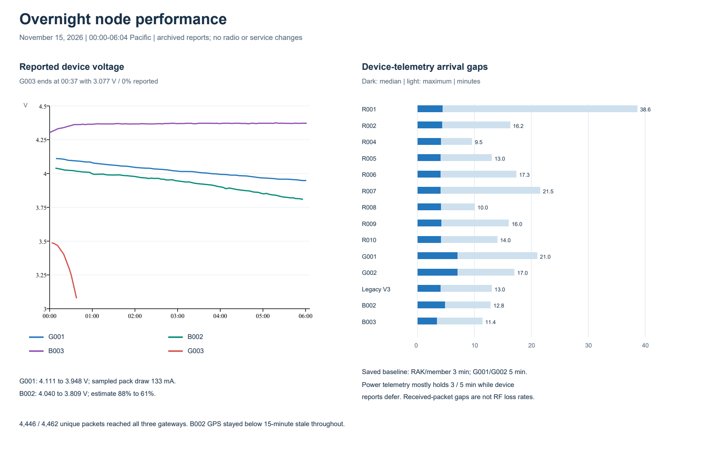

# Overnight bench analysis — November 15, 2026

Read-only review of the existing production MQTT archive and bounded service
journals. Main window: **00:00:00–06:04:15 Pacific**, **6 h 4 min** on
November 15 (**08:00:00–14:04:15 UTC**). Evening context starts at 18:00 on
November 14. Window boundaries describe available evidence, not when the owner
powered or left each board. Queries use SQLite `mode=ro`, `query_only=ON` and a
consistent read transaction. No serial port, MQTT subscription, RF command,
configuration, portal registration or running service was changed.

## Findings

- **Strong agreement between the three receiving gateways:** 4,462 unique
  overnight packets; 4,446 (99.64%) reached G001, fresh G002 and Legacy V3.
  Fourteen radios were still reporting near the end; G003 stopped at 00:37:52.
  No overnight device-uptime decrease or custom-report boot-ID change was
  observed in reporting nodes. R003 and R011 were not heard in either window.
- **B002 tracking remained fresh:** 143 timestamped GPS positions; no measured
  or reconstructed displayed fix age crossed 15 minutes. B003 is currently the
  survey tester, which deliberately suppresses ordinary position broadcasts.
  R009 sent no position and all 269 of its standard telemetry reports lacked UTC.
- **Device/environment reporting is slower than the saved profile.** RAK
  device medians are approximately four minutes against three configured;
  R001's largest device gap is 38.6 minutes. Power telemetry mostly holds
  three minutes. Received packets alone cannot establish attempted RF loss.
- **G003 power is the immediate physical follow-up:** its last device report
  is 3.077 V / 0% estimated, followed by silence at all receiving gateways.
  Low-voltage shutdown is a plausible explanation, not an observed shutdown event.
- **Portal ingestion remains incomplete:** R004/R006/R008 deliver archived
  packets, but their 3,085 overnight transport receipts are rejected as unknown
  sources. This is separate from radio reception.
- **Both SD gateways remain healthy in reported data:** one boot each,
  flags 15 and zero reported dropped records; both upload their own and peers'
  reports. The scheduled server backup stopped/restarted API and worker around
  02:30–02:32 and completed successfully; the private receipt queue was empty
  at inspection.

## Identity and observation scope

Fresh labels were resolved by physical radio IDs from the local deployment
roster and November 14 provisioning records, rather than old number-based
profiles. G003 here is **!849ad7a0**, the newly provisioned mobile V3; Legacy V3
is **!9ea13cc0**. Server mappings still contain historical assignments. A name
alone must not select a physical board.

| Physical label | Radio ID | Unique overnight packets | Last receipt, Pacific |
| --- | --- | ---: | --- |
| R001 | !f95b5501 | 345 | 06:03:57 |
| R002 | !05237743 | 353 | 06:01:57 |
| R004 | !49ac6d7f | 338 | 06:03:20 |
| R005 | !a65601b3 | 341 | 06:03:10 |
| R006 | !638b9515 | 347 | 06:03:01 |
| R007 | !b456f760 | 338 | 06:03:56 |
| R008 | !120b04fd | 344 | 06:02:39 |
| R009 | !da581e5f | 353 | 06:02:55 |
| R010 | !77fdb9f1 | 337 | 06:04:03 |
| G001 | !1bbf0638 | 348 | 06:02:22 |
| G002 | !1bbf0ab8 | 352 | 06:04:10 |
| Legacy V3 | !9ea13cc0 | 237 | 06:02:23 |
| B002 | !699ca878 | 292 | 06:04:00 |
| B003 | !699c2ed8 | 108 | 06:01:39 |
| G003 | !849ad7a0 | 29 | 00:37:52 |

The ten ordinary deployment RAKs were updated to survey responder firmware on
November 14: R001/R002/R004–R011, with R003 held. R011's former REF1 profile
retains bench restrictions and has no newly accepted over-the-air result;
absence from the archive does not diagnose its hardware. The other nine RAKs
are represented above. Earlier ordinary-image bench passes do not prove
current survey-image or final ROUTER field acceptance.

Evening context is less stable and overlaps commissioning. After 18:00, B002
has one observed uptime decrease (22:52), B003 seven (latest 23:31), and G002
two (22:13 and 23:28), plus multiple custom-report boots. G003 has three
reported boot IDs. Those records show resets/boot changes, but cannot assign
them to crashes rather than flashing, USB access or deliberate power cycles.
The midnight comparison follows these events; its no-observed-reboot finding
must not be extended to the whole evening.

## GPS and clocks

**B002:** all **143 positions** include coordinates and a GPS measurement
timestamp. Measurement age at first archive receipt: median
36.8 s, p95
104.9 s, maximum
291.1 s. Packet receipt interval: median
145.2 s, maximum 337.8 s, against the saved 120-second broadcast baseline.
Using the latest preceding fix at midnight and aging the newest valid
measurement between arrivals, the worst displayed fix age is **460.3 seconds
(7.67 minutes)**, including the window end: **zero time over 900 seconds**.
Satellite counts range 4–9; reported PDOP ranges 1.55–8.88. Freshness does not
establish metre accuracy, measured route quality or forced-relay performance.

**B003 !699c2ed8:** zero GPS position packets, but 95 device reports and 108
total packets. This physical board is the selected survey tester. The survey
client classifies all own POSITION_APP packets as PositionTx and unconditionally
suppresses that class; local USB GPS and survey GPS snapshots are separate.
The [exact tester implementation](https://github.com/lfg-seth/firmware/blob/7b766e6eba20f304d13c534bf1de4acd9f29d3e6/src/modules/DirectSurvey.cpp)
explains why the device cannot simultaneously be counted as a passive portal
GPS tracker. The latest stored B003 position is November 14 **14:21:37 Pacific**,
before this run. This is not evidence of a failed GNSS receiver. Its member
tracking acceptance requires a separately selected role/build and a new run.

**R009 !da581e5f:** zero positions; all **77 device + 73 environment + 119 power
= 269** telemetry packets have unknown UTC. The rest of the fleet contributes
**2,558 clocked standard telemetry packets**, without observed future
timestamps or per-stream clock regressions. R009 uptime grows from 2,527 to
24,137 seconds in device samples. Thus the clock issue persists well beyond
initial boot, despite ongoing reception by all three gateways. Previous
ordinary-image time/position results do not carry forward to this run. Sky view,
local GNSS state, current profile and clock acquisition need selected readback;
the archive cannot isolate the cause.

## Reporting cadence and channel load

All gap entries below are **median / maximum minutes between unique arrivals**.
Environment can carry INA219 voltage/current without temperature/humidity.
An em dash indicates no packet in the window, rather than a zero measurement.
Configured baselines used for comparison: RAK/member device 180 s, RAK
environment/power 180 s, SD gateways 300 s. Gateway health and SD packets
advertise 300 s in this run. NodeInfo and standard NeighborInfo are long-period
streams and are not judged against three minutes.

| Node | Device gap, min | Environment gap, min | Power gap, min | SNNS gap, min | Sampled busy %, mean / max |
| --- | --- | --- | --- | --- | --- |
| R001 | 4.35 / 38.60 | 3.98 / 15.92 | 3.01 / 6.26 | 4.08 / 10.97 | 20.2 / 25.0 |
| R002 | 4.28 / 16.25 | 4.09 / 15.22 | 3.00 / 5.98 | 4.01 / 10.01 | 20.1 / 24.9 |
| R004 | 4.07 / 9.55 | 4.07 / 19.18 | 3.00 / 6.10 | 4.24 / 10.32 | 18.3 / 24.3 |
| R005 | 4.02 / 13.00 | 4.04 / 27.83 | 3.00 / 6.09 | 4.22 / 9.93 | 19.3 / 24.6 |
| R006 | 4.01 / 17.32 | 4.60 / 20.05 | 3.00 / 3.48 | 4.00 / 12.97 | 20.9 / 25.0 |
| R007 | 4.01 / 21.51 | 4.07 / 20.68 | 3.00 / 8.90 | 4.21 / 9.56 | 21.3 / 25.0 |
| R008 | 4.06 / 10.00 | 4.26 / 16.00 | 3.01 / 6.03 | 4.05 / 15.75 | 19.6 / 24.9 |
| R009 | 4.16 / 16.02 | 4.14 / 26.96 | 3.00 / 6.06 | 4.19 / 11.14 | 20.4 / 25.0 |
| R010 | 4.09 / 13.99 | 4.85 / 21.88 | 3.00 / 6.01 | 4.22 / 11.75 | 18.9 / 24.9 |
| G001 | 7.00 / 21.00 | — | 5.00 / 5.00 | 5.63 / 10.25 | 20.6 / 24.9 |
| G002 | 7.00 / 17.00 | — | 5.00 / 5.01 | 6.00 / 9.50 | 20.6 / 24.9 |
| Legacy V3 | 4.01 / 13.01 | — | — | 4.01 / 8.26 | 19.5 / 24.7 |
| B002 | 4.76 / 12.82 | — | — | 4.14 / 10.41 | 20.3 / 24.8 |
| B003 | 3.39 / 11.37 | — | — | — | 12.8 / 24.8 |
| G003 | 6.07 / 8.63 | — | — | 3.85 / 6.14 | 20.9 / 24.8 |

R001's maximum device receipt gap is **02:35:41–03:14:17 Pacific**, 2,316.3 s;
its embedded source-time gap is **2,280 s**. G001's corresponding largest gap
is 1,260.1 s, with a **1,260 s source gap**; G002 reaches 1,020.1 s. These
source gaps are much larger than ordinary source-to-receipt delay: gateway
telemetry averages below one second, while clocked RAK samples average about
9–23 seconds. Power reports continue while the device stream is overdue.
For example, G001 power intervals never exceed 300.3 seconds overnight.
These patterns do not resemble whole-node uptime loss.

The installed-family source gates polite device/environment sends below
**25% channel utilization** and checks airtime; power has different scheduling.
See the pinned [admission logic](https://github.com/lfg-seth/firmware/blob/f6cdbeb3f390f6dcf31c8e909cb4fcd1b24a9cdc/src/modules/Telemetry/DeviceTelemetry.cpp)
and [airtime thresholds](https://github.com/lfg-seth/firmware/blob/f6cdbeb3f390f6dcf31c8e909cb4fcd1b24a9cdc/src/airtime.h).
Sampled device busy values mostly average 18–21% and approach 25%. These
samples are selected at successful report generation: they cannot establish
the busy values while a report was skipped. Scheduling/admission is consistent
with the evidence, but sender logs and attempt counters are needed to separate
deferred generation, RF loss and survey quiet. No admission setting was changed.

## Gateway agreement and backend continuity

| Uplink | Unique packets seen / union observed | Share of observed union |
| --- | ---: | ---: |
| G001 !1bbf0638 | 4,456 / 4,462 | 99.87% |
| G002 !1bbf0ab8 | 4,457 / 4,462 | 99.89% |
| Legacy V3 !9ea13cc0 | 4,449 / 4,462 | 99.71% |
| Both SD gateways | 4,454 / 4,462 | 99.82% |
| All three gateways | 4,446 / 4,462 | 99.64% |

The denominator is the union of packets observed anywhere, not attempted
transmissions. This comparison cannot detect packets missed by every gateway,
nor packets never generated during silence. Self-originated gateway packets
reach their own uplink without RF. Most peer copies have zero hops, with some
positive-hop copies; direct reception was not excluded, so this is not
forced-relay or field-range acceptance.

G001/G002 contribute 61/59 unique backhaul generations respectively, all
reporting Wi-Fi and MQTT connected. Legacy V3's 85 backhaul generations also
report both connected. G003's ten overnight backhaul generations report both
disconnected; it is heard by peers but provides no own overnight MQTT uplink.
Its vehicle Wi-Fi availability is not established by this run.

The backup service ran **02:30:04–02:32:02 Pacific**, exited 0 and reports
success. API/worker start at 02:32:02 with no automatic restart count after
that start. Archive arrivals contain a matching gap around 02:30–02:32,
including no row in the 02:31 minute. The worker records one API-unavailable
event at restart, with no matched fatal/exception/disk-full event in the
bounded journal scan. This intentional collector interruption limits all-night
delivery claims; an empty durable queue afterward does not prove recovery of
RF packets never received while the subscriber was stopped. Earlier evening
service stop/start cycles overlap provisioning and are not assigned a crash
cause by this analysis. Feed heartbeat was 1.2 s old at the archive snapshot.
Later service inspection finds **zero queued receipts** and **28% host disk use**.
The external broker's own journal was not inspected.

Normal worker outcomes for the observed overnight transport receipts are
10,190 normalized, 3,085 unknown-source rejections and 87 unsupported packets.
The roster-aware independent decoder successfully reads the rejected R004,
R006 and R008 packets in memory: 1,012 / 1,041 / 1,032 copies respectively.
The run establishes the existing registration gap without changing registry
or replaying history. Unsupported app packets alone do not imply radio failure.

## Power and environment

**Current below uses raw INA219 wire polarity: positive = discharge/draw,
negative = charging.** The portal/dashboard invert that sign for display.
Values are sparse sample means, not continuous electrical averages or TX peaks.
Firmware level 101 means charging/no detected battery, not 101% charge.

| Node | Device V, first → last | Firmware level, first → last | INA219 V, first → last | Raw INA219 current mean, mA |
| --- | --- | --- | --- | ---: |
| R001 | 3.741 → 3.803 | 101 → 101 | 3.732 → 3.792 | -307.8 |
| R002 | 3.691 → 3.734 | 101 → 101 | 3.664 → 3.712 | -321.2 |
| R004 | 3.824 → 3.990 | 101 → 101 | 3.800 → 3.964 | -284.2 |
| R005 | 4.168 → 4.211 | 101 → 101 | 4.172 → 4.220 | -103.0 |
| R006 | 3.820 → 3.993 | 101 → 101 | 3.788 → 3.960 | -288.8 |
| R007 | 3.793 → 3.949 | 101 → 101 | 3.748 → 3.900 | -293.2 |
| R008 | 4.126 → 4.180 | 101 → 101 | 4.120 → 4.176 | -215.3 |
| R009 | 4.115 → 4.159 | 101 → 101 | 4.080 → 4.120 | -184.6 |
| R010 | 3.705 → 3.746 | 101 → 101 | 3.696 → 3.736 | -309.0 |
| G001 | 4.111 → 3.948 | 94 → 75 | 4.012 → 3.856 | 133.0 |
| G002 | 4.000 → 3.993 | 81 → 80 | 3.760 → 3.820 | -523.2 |
| Legacy V3 | 4.338 → 4.326 | 101 → 101 | — | — |
| B002 | 4.040 → 3.809 | 88 → 61 | — | — |
| B003 | 4.303 → 4.372 | 101 → 101 | — | — |
| G003 | 3.488 → 3.077 | 26 → 0 | — | — |

**G001:** 72 power samples average **133.0 mA discharge**, range 119.9–178.4 mA.
Device voltage falls 4.111→3.948 V and estimate 94→75%; INA219 voltage falls
4.012→3.856 V. If sustained, that sample mean is equivalent to approximately
**3.19 Ah per day at the monitored battery path**, before conversion, solar,
weather and reserve assumptions. This is a conditional charge budget, not a
measured capacity or full-discharge runtime. The prior owner clarification
identifies the INA219 as battery-inline; this run does not reverify calibration
or the unchanged wiring.

**B002:** voltage falls 4.040→3.809 V and estimate 88→61%. Device uptime
increases without reset across more than six hours, and fresh GPS continues.
There is no INA219 sample or verified unplug/charge history for this run, so
continuity supports sustained tracking but does not close battery-only runtime
acceptance or justify extrapolating remaining hours from estimated percentage.

**G003:** 3.488→3.077 V and 26→0% between its overnight device reports. The last
report at **00:37:52** is heard through all three receiving gateways. No later
packet appears by 06:04:15. Check the physical power/charge state before using
this unit as an overnight backhaul. The archive does not prove whether it
shut down, was disconnected or was otherwise moved/offlined.

**Charging group:** all nine reporting RAKs show level 101 and negative mean
battery-path current. G002 reports about **−523.2 mA**, also indicating charge
under the recorded polarity. R005 current tapers from −199.7 to −43.3 mA as its
INA219 voltage rises 4.172→4.220 V. These are charging observations, not
RAK/G002 operating consumption or autonomous battery runtime. Do not compare
them as discharge means against the November 13 mixed-power run. G002 capacity,
actual power path and calibration are not supplied here.

Actual temperature/humidity pairs appear on R001/R002/R006/R008/R010. Their
first-to-last temperatures fall by about 0.8–3.4 C while humidity rises. The
sampled temperature range across those boards is approximately 20.4–26.5 C.
Other RAK environment packets without those fields do not establish AHT21
presence. No outdoor weather or enclosure/thermal acceptance is inferred.

## SD logging

| Gateway | Unique SD generations | Used bytes, first → last | Reported filesystem total bytes | Growth equivalent, MB/day | Reported drops |
| --- | ---: | --- | ---: | ---: | ---: |
| G001 | 62 | 7,667,712 → 10,911,744 | 31,902,400,512 | 12.93 | 0 |
| G002 | 61 | 704,512 → 3,932,160 | 31,896,633,344 | 12.97 | 0 |

Both remain on one recorder boot, advertise 300 seconds, carry clock source 3,
retain flags **15** and report **zero drops**. Storage grows monotonically.
G001 sequences 316–377 and G002 sequences 14–74 have no missing sequence in
the selected observations. Their generation intervals can exceed 300 seconds;
normal admission/defer behavior is preserved. The current growth equivalence
describes this bench load only. Mounted-card reports do not prove every log
record, copied-file readability, physical capacity or recovery after power loss.

## Follow-up order and evidence

1. Check/recharge G003 and verify power state and intended vehicle backhaul
   before depending on it. Select a measured unplugged runtime test afterward.
2. Read R009's local GNSS, clock and current profile with agreed sky view;
   verify a real position measurement timestamp through gateways. Keep B003's
   tester role separate from passive member tracking acceptance.
3. Reconcile fresh R004/R006/R008 IDs with portal registration under a selected
   live change, then verify authenticated cards/receipts. The archive already
   contains their traffic; no replay or registration was performed here.
4. Capture selected sender scheduling/admission diagnostics for the long
   device/environment gaps, including the R001 38-minute case. Reverify
   role/profile/cadence at final placement; do not waive airtime checks to make
   a dashboard green. Existing dashboard cadence metadata predates fresh G002
   and the 300-second SD change and must not be used unchanged as acceptance.
5. Copy and inspect selected SD files, then run agreed battery-only, outage,
   forced-relay and field checks. R003 remains held; R011 RF acceptance remains
   unverified. These are follow-ups, not newly executed changes.

Private sanitized measurements, collector, analysis, chart source and bounded
service metadata: `private/overnight-analysis-20261115/`. Raw packet bytes,
credentials, GPS coordinates and member names remain on the server. The
sanitized snapshot's SHA-256 is
`33f6ae8cab92ad3203c35fe026c9822e24e7abb3aeb7cba595600660dd0b026c`.
Validation checks unique packet identities, packet/node count consistency,
copy arrival ordering, absent latitude/longitude fields, the continuous B002
freshness reconstruction, and zero decoder exceptions. The trend image was
rendered and visually inspected. All four changed Markdown files pass the
document-link and Git-whitespace checks. This record is a sustained bench observation, not final
deployment, field, calibrated power or loss-free network acceptance.
