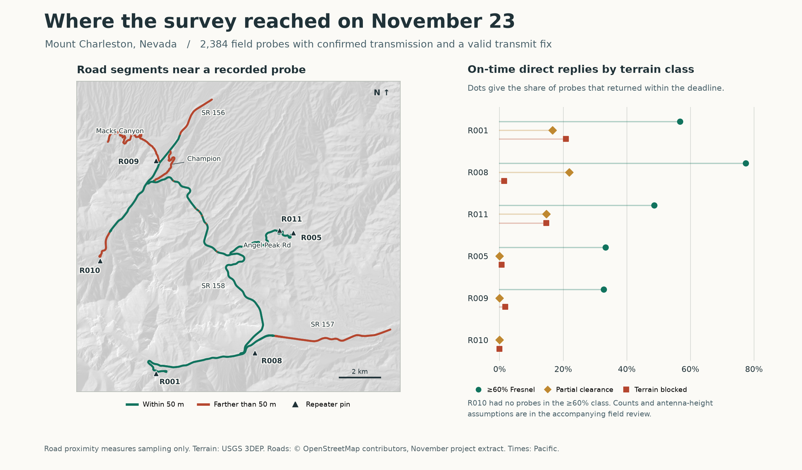

# November 23 field survey, terrain and remaining tests

**Start the next outing at Upper Bristlecone and Mack’s Canyon, with a battery-powered member node recording throughout.** Upper Bristle had no clear-path control in the drive. The saved Mack’s repeater pin is only 41 m from the November 18 scout point, yet that offset changes the predicted link to Upper Bristle from clear to obstructed. These two checks would answer more than another lap of the Angel road. The remaining mission question is whether a member walking beyond the vehicle can keep a fresh position at dispatch. [Pilot requirements](../../../PROJECT.md#confirmed-direction) · [November 18 siting study](https://github.com/lfg-seth/snorr-meshlink/blob/fa721c489dfa41de9739554add9a553b2bef9361/docs/research/mountain-node-study-20261118.md)

## What the radio actually measured

The recorder ran from 11:31 to 17:23 Pacific on November 23. Its 19 sessions contained 2,477 attempts. Two single-probe bench checks timed out (R007 and R008). The 17 field sessions selected six fixed targets and recorded **726 on-time replies in 2,452 completed attempts (29.6%)**. Another 23 attempts were cancelled. Every on-time reply matched the selected target with validated zero-hop evidence. Each exchange required a ping to reach the repeater and a reply to reach the survey radio before the 4.5-second deadline. An ordinary member position only needs to reach a gateway, possibly through relays. The two measurements answer different operational questions. [Recorder and bench evidence](../../field-results.md#2026-11-23---survey-recordings-and-test-results)

| Selected repeater | On time / completed field probes | ≥60% first Fresnel zone clear | Line clears ground, <60% Fresnel | Terrain crosses line | Farthest on-time reply |
| --- | ---: | ---: | ---: | ---: | ---: |
| R001 Cathedral Rock | 230/492 (46.7%) | 208/367 | 3/18 | 19/91 | 5.99 km |
| R008 Escarpment Trail | 191/450 (42.4%) | 175/226 | 14/64 | 2/145 | 5.03 km |
| R011 Angel Peak Mountain Side | 282/1,190 (23.7%) | 158/325 | 6/41 | 118/803 | 4.91 km |
| R005 Angel Peak Vegas Side | 4/161 (2.5%) | 3/9 | 0/3 | 1/147 | 4.73 km |
| R009 Mack’s Canyon | 19/128 (14.8%) | 18/55 | 0/1 | 1/58 | 2.94 km |
| R010 Upper Bristle | 0/31 (0%) | No probes | 0/2 | 0/29 | No reply |
| **All field targets** | **726/2,452** | **562/982 (57.2%)** | **23/129 (17.8%)** | **141/1,273 (11.1%)** | |

The terrain columns use the 2,384 completed field probes with a recorded TX completion and valid transmit position. Of the other 68 timeouts, 18 had a recorded TX start and 50 lacked a start record at expiry. Their location cannot establish a completed RF test. Farthest reply is straight-line distance to the saved pin. It gives one successful observation at that distance.

**Terrain explains much of the pattern.** On-time replies were about five times as frequent on paths clearing 60% of the first Fresnel zone as on terrain-blocked paths. R008 showed the clearest split, 77.4% versus 1.4%. Its 13:55 drive had 152/203 on-time replies overall. Its 14:27 Angel road run had 0/35, all 35 behind terrain. R005 had just nine fully clear probes, all its successes were recorded along SR 158, and the run never sampled a valley-facing receiver. R010’s short SR 156 run reached only obstructed or marginal paths. Both radios need a clear-path comparison before drawing a range or equipment conclusion.

**Terrain leaves two important discrepancies.** First, 420 of the 982 fully clear probes still missed the deadline. Near Cathedral Rock, seven clear probes in one 200 m cell beginning at 12:13:45 all missed near Kyle Fire Station, while another clear cell on SR 157 produced 71/91 replies across the survey. Second, R011 returned 118 of all 141 blocked-path successes, including four where the modeled obstruction exceeded 50 m. The zero-hop evidence establishes direct RF contact for those packets. The recorder has no timestamped visual sightings or surveyed antenna mounts. Pin offsets, terrain resolution, diffraction, reflections, vehicle orientation, vegetation and radio timing remain possible contributors. The data do not identify the mechanism for an individual miss or reception. [USGS elevation references](https://www.usgs.gov/faqs/what-projection-horizontal-datum-vertical-datum-and-resolution-a-usgs-digital-elevation-model) · [ITU-R diffraction guidance](https://www.itu.int/rec/R-REC-P.526/en)

**Few missed deadlines had a recorded late reply, and the gain change produced no consistent improvement on the drives.** Among on-time replies, median enqueue-to-reception time was 2.45 seconds. Of 1,728 total timeouts, only 38 later acquired a matching reply. Counting every one would raise the completed-attempt rate from 29.6% to 31.1%. Three more late replies followed cancellations. The R011 before/after drives returned 139/557 and 112/440 on time. Among 301 location-matched pairs within 25 m, the totals were 74 before and 78 after. Tightening the match to 10 m reversed the small difference (62/195 and 59/195). The gain setting and admin enrollment survived reboot. A stationary weak-link test with R011’s own USB log is still needed to measure the gain effect. [Paired drive and packet timing evidence](https://github.com/lfg-seth/snorr-meshlink/blob/32decafe1c0a85e91f8c17a1abea9ac6f1d2e2b1/records/field-results.md#2026-11-23---r011-survey-before-and-after-boosted-rx)

## Which roads and links still need testing

| Project road section | Length within 50 m of any qualifying probe / modeled length | What remains |
| --- | ---: | --- |
| SR 158 / Deer Creek | 13.95 / 14.25 km | Most of the road had a nearby test of at least one target. Alternate targets at the same stops, then check an ordinary member fix through Lee Fire. |
| Angel Peak road and branches | 4.79 / 4.89 km | Compare R005 and R011 at identical stops on each face. Add a separate valley-facing receiver if valley coverage is the question. |
| SR 157 / Kyle Canyon | 8.88 / 15.22 km | The easternmost 5.44 km modeled segment had no nearby qualifying probe. Repeat the Kyle Fire anomaly and use Cathedral Rock Picnic Area for a two-target control. |
| SR 156 / Lee Canyon | 6.15 / 10.14 km | Fill the upper 1.29 km section and about 2.38 km at the northeast end of the long highway segment. Include the Upper and Lower Bristlecone trailheads. |
| Mack’s Canyon road | 0.10 / 5.31 km | All 114 qualifying R009 probes were near SR 156. The road-mouth observations leave the canyon interior open. |
| Champion road | 0.10 / 2.63 km | Almost the entire interior remains open. Compare the entrance, first terrain bend and a farther accessible stop. |

The road measure splits each mapped part into intervals of at most 50 m, checks each midpoint against the nearest qualifying transmit position and sums the interval lengths. A probe of any target counts even if it timed out. A point near a junction can mark two roads. The figure represents sampling opportunity. The full-day recording establishes neither continuous service along the green sections nor loss along the red ones. No identified member-carried trail run measured body-height delivery at walking pace. [Study geometry and road definitions](../../../scripts/winter-siting/README.md) · [OpenStreetMap contributors](https://www.openstreetmap.org/copyright)

The two Angel repeaters also had an unequal opportunity to answer. Matching transmit positions nearest-first, once per probe, within 25 m gave **98 cross-target pairs**. R005 answered four and R011 answered 22. In 75 pairs both probes timed out. These were separate passes. A same-stop, alternating-target run would distinguish a repeatable overlap gap from different timing or vehicle headings. For the same reason, the November 18 estimate of 12.78 of 39.61 highway km reachable with its proposed Angel survey 5 layout cannot be graded using a two-way ping rate to individual deployed radios. That estimate assumes a route to Lee Fire and a different roster.

### Fixed links worth testing first

These profiles use the November 23 roster, native 1 m terrain and antennas 4 m above ground at both ends. Positive clearance means the modeled straight path clears bare ground. The November 18 scout appears as a separate comparison.

| Endpoints | Distance | Minimum clearance | Field implication |
| --- | ---: | ---: | --- |
| November 18 Mack’s scout → R010 | 5.58 km | +2.0 m, 68% of first Fresnel radius at the tightest Fresnel point | A promising comparison point with limited margin. |
| November 23 R009 pin → R010 | 5.61 km | **−7.8 m**, deepest obstruction about **59 m from R009** | Verify the actual mount and compare with the scout 41 m away before relying on this relay leg. |
| R001 → R008 | 4.94 km | +4.1 m, clears 60% Fresnel | A positive control for a direct fixed-radio test. The mobile replies to each site did not exercise this fixed pair. |
| R005 → R011 | 0.70 km | **−45.4 m** | Their proximity on Angel Peak hides intervening terrain. Check each face independently and measure any proposed cross-peak relay. |
| R011 → R009 | 6.94 km | +0.6 m, about 3% Fresnel | A marginal alternative worth checking while both sites are staffed. |

## Recommended order for the next outing

1. **Start a phone-free member run and verify the receiving gateway.** Use a positively identified member-profile radio on battery. Record which physical unit is acting as SURV separately, since the copied survey identity and historical B003 label can be confusing. Verify a new measured position and packet ID locally and at G002/Lee Fire and dispatch before leaving. Walk beyond the vehicle and keep the member run going through the stops below. Record duty times, fix time, first receipt time, gateway, maximum position age, minutes stale and power interruptions. Agree the acceptable stale fraction before departure. The existing gates are stale at 15 minutes, four hours minimum battery runtime and twelve hours target. On a planned backhaul interruption, compare local/SD receipts with dispatch before and after reconnection. Check whether the operator can see both the last position and its age offline. [Pilot needs](../../../.scratch/pilot/issues/02-pilot-needs.md) · [Member field acceptance criteria](../../tracking-import/github-2.md)
2. **Upper Bristlecone → Mack’s Canyon.** Start with R010 at the Upper Bristlecone Trailhead. The mapped point is about 29 m from its saved pin and clears 60% Fresnel. The Lower Bristlecone Trailhead is a useful edge comparison, about 635 m away and 25% Fresnel-clear at the modeled roof height. Establish a close direct reply and a new member fix, then test fixed R009↔R010 in both directions. Compare the installed Mack’s pin with the prior scout using a temporary tester at matched, measured heights. Repeat the original point after the scout. Carry the member node beyond the SR 156 junction into Mack’s Canyon and Champion where accessible. Record a packet ID through the intended relay to Lee Fire with direct gateway reception excluded or separately identified.
3. **Kyle Canyon → Deer Creek.** At Cathedral Rock Picnic Area both R001 and R008 have native-terrain paths clearing 60% at modeled roof height. Alternate targets from the same position, then repeat near the 12:13:45 Kyle Fire cell and along the eastern SR 157 gap. On SR 158 revisit a successful R008 location and a terrain-screened one on the Angel approach. Repeat with the tracker carried on foot. A strong roof-mounted link paired with stale body-carried fixes would change the pilot decision.
4. **Angel Peak.** At one clear stop, one weak stop and one screened stop, alternate R011 and R005 with the same tester, antenna height, orientation and power. Start USB recording at the responder before the first ping. Match request ID, local TX, remote RX, reply TX and local RX. Keep the production 4.5-second deadline for the baseline. Use equal blocks for a longer-window comparison and vary one setting at a time. A practical first block is 20 probes per target per stop, repeated in reverse order. This is a sampling proposal. A separate fixed outdoor receiver on the Vegas-facing side would test the valley prediction.

## Other November 23 checks and their limits

- **Moving GPS fallback was exercised.** After the dual-GPS update, 218 qualifying field transmissions across seven sessions used a laptop fix, and 42 returned on time. Two R011 probes enqueued at 14:59:37 and 14:59:41 had laptop transmit fixes about 70 m apart and the second returned on time. The nearby state sample showed stale onboard GPS and fresh laptop GPS. This advances the stationary bench result. The two earlier 119.6-second onboard outages remain consistent with the reproduced 120-second retry. Continuous onboard acquisition across those deadlines and a timed loss and recovery of both sources still need verification. [Firmware selection at TX](https://github.com/lfg-seth/firmware/blob/35b35d51b46a217ea3d5085394af59d1f0c8c6b5/src/modules/DirectSurvey.cpp) · [GPS and recorder tests](../../field-results.md#field-and-bench-findings)
- **Member tracking and power.** The separate 48-hour production archive ending at 09:48 Pacific contained traffic from all nine field-roster radios. B003 supplied 295 distinct fixes over 4 h 58 min on Saturday with no 15-minute gap between fixes. Both member positions were stale at Monday cutoff and intended duty periods are unknown. That window supports sustained reporting while active. It leaves battery-only runtime, phone independence and live position age on this route open. The same archive showed repeated boots at G002 and G006, only self-originated receipts through G006, a 43% ending estimate at R009 and all 509 R011 net-current samples in discharge. Check gateway reset causes and collect daylight panel/charge measurements while at those sites. This morning archive predates the drive. The aggregate is retained locally at `private/fleet-review-20261123.txt`.
- **G003 and MQTT.** The broker loopback and private proxy each answered 6/6 probes. The public TCP 8883 path was intermittent from both laptop and portal, and the portal worker lost its subscription while its heartbeat stayed fresh. G003’s USB replies resumed after a seven-second MQTT connection attempt. Match a locally observed packet against gateway and broker logs during the next interruption. A missing portal packet alone cannot locate an RF failure. [MQTT investigation and live checks](../../field-results.md#field-and-bench-findings)
- **Field software, gateway firmware and portal.** The dual-GPS build passed 21 recorder checks, eight adapter checks and both native controller targets. Wi-Fi HTTP 200 came from the laptop itself. Second-device Wi-Fi and physical iOS map behavior remain open. The screenless V4 image and four release assets verified, with hardware downlink and forced relay still open. MeshLink 0.4.16 passed 101 backend, 72 portal and 55 script tests, file verification and both recovery checks. The signed-in Activity rendered member data. Verify a newly generated ordinary member GPS packet end to end on the field run. [Checks, artifacts and individual handoffs](../../field-results.md#field-and-bench-findings)

## Analysis inputs and sensitivity

The survey ZIP matched the published SHA-256. Both archives passed ZIP CRC checks and SQLite returned `ok` on its integrity check. Join each `attempt` to its primary `result` by payload session ID and attempt ID. Count late replies against their original outcome. For terrain and road analysis require field mode, success or timeout, TX completion and valid result GPS at transmit. Use the archive’s six fixed-site pins, including R008 at Escarpment Trail. Project WGS84 fixes into NAD83 / UTM 11N. Use terrain plus antenna height at both endpoints. The project’s local 5 m USGS mosaic covered every qualifying path. Sample at 5 m or finer with bilinear interpolation, a 4/3 effective Earth radius and 910.625 MHz. Exclude endpoints when taking minimum straight-line and first-Fresnel clearance. A second calculation with the repository’s terrain ray routine agreed on all 2,384 classifications. The fixed-link and named-stop checks use the project’s native 1 m profile routine. [Raw data and checksums](../../field-results.md#2026-11-23---survey-recordings-and-test-results) · [Terrain routines](../../../scripts/winter-siting/terrain.py) · [Native profiles](../../../scripts/winter-siting/native.py)

The baseline uses **2.2 m at the vehicle and 4 m at the repeater**. These are planning values. One Cathedral session mentions a six-foot fiberglass antenna extension. Actual antenna phase-center heights and as-mounted ground positions were unmeasured. At 1.2/2 m the clear and blocked reply rates were 59.0% and 11.2%. At 3.2/6 m they were 55.6% and 10.8%. To reduce dwell-time weighting, averaging within each target’s 100 m UTM grid cell and then weighting occupied cell/target combinations equally within each class gave 49.4% clear, 20.5% partial and 5.5% blocked. The ordering survived both checks. These estimates describe the sampled routes and selected targets. Repeated nearby probes share terrain, traffic and vehicle orientation.
